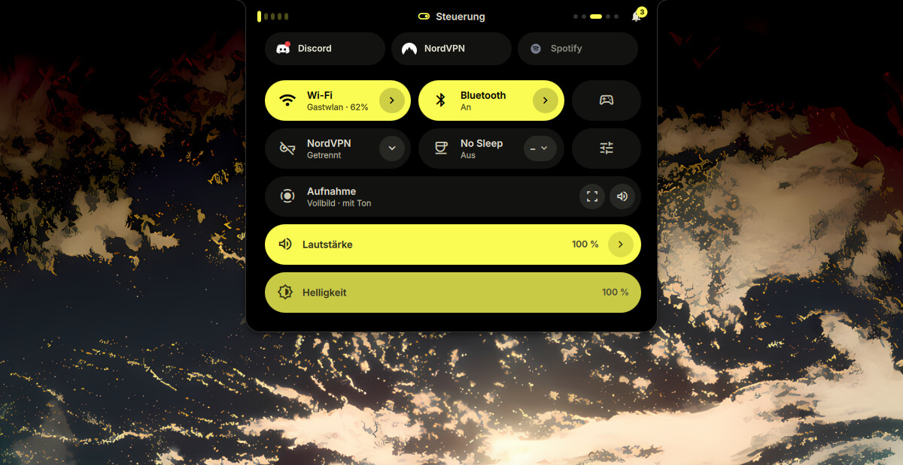
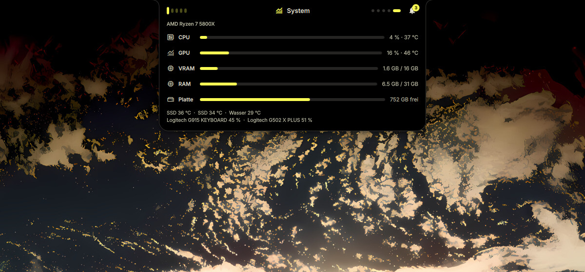

# Hyprland-Rice — Dynamic Island

**English** · [Deutsch](README.de.md)

> [!WARNING]
> **AI notice:** A large part of this repo — the Quickshell interface, the
> CLI, the install script and this README — was written with AI
> (Claude Code). I use it every day myself, but it is a hobby project that
> nobody else has reviewed. The install script changes your system (symlinks,
> directories, color scheme files for GTK/Qt/btop/Discord) — read it before
> you run it.

My Hyprland config with its own Quickshell interface ("dynamic-island"): a
bar with a notch, media card, wallpaper and theme picker, Wi-Fi settings —
plus the `dynamic-island` CLI (color schemes, wallpapers, screenshots,
recordings).


<table>
  <tr>
    <td width="50%"><br><sub><b>Media</b> — cover, lyrics, queue (via the notch)</sub></td>
    <td width="50%"><br><sub><b>Controls</b> — Android-style quick settings (<code>SUPER + A</code>)</sub></td>
  </tr>
  <tr>
    <td><br><sub><b>App menu</b> — <code>&gt;</code> for actions (<code>SUPER</code>)</sub></td>
    <td><br><sub><b>System</b> — CPU, GPU, RAM, temperatures (<code>SUPER + I</code>)</sub></td>
  </tr>
  <tr>
    <td><br><sub><b>Wallpapers</b> — the color scheme follows the image</sub></td>
    <td><br><sub><b>Themes</b> — ready-made and generated schemes</sub></td>
  </tr>
</table>


<sub><b>Keybind overview</b> (<code>SUPER + K</code>) — live from Hyprland, click to run</sub>

<sub>The screenshots show the German interface.</sub>

## Installing

```sh
git clone https://github.com/Gamecat-HD/Hyprland-Rice.git
cd Hyprland-Rice
./dynamic-island/install.sh --install-deps
```

The script places `hypr/`, `quickshell/dynamic-island/` and `dynamic-island/`
into `~/.config` — as symlinks by default, so a `git pull` in the clone
applies right away. Whatever is already there is moved to `~/backups/` first;
nothing is deleted.

It also puts the bundled wallpapers into `~/Pictures/Wallpapers` (existing
files are left alone). Only my own are included — the big collection the
rest of the folder comes from is at `github.com/krishna4a6av/Wallpapers` and
can be cloned next to it if you want.

Then:

```sh
hyprctl reload            # Hyprland reads the new config
dynamic-island shell -d   # start the shell
```

It doesn't matter where the clone lives. If you'd rather use the clone *as*
`~/.config`, that works too — then there's nothing to place.

## First steps after installing

The config is tailored to my machine. You'll almost certainly have to adjust
a few things. Thanks to the symlinks, `~/.config/hypr` is the same folder as
`hypr/` in the clone — wherever you edit, it's the same file. After every
change: `hyprctl reload`. Hyprland reports typos as a red bar at the top.

### 1. Monitors (most important)

First check what your screens are called:

```sh
hyprctl monitors    # names like HDMI-A-1, DP-1, eDP-1 + available resolutions
```

The top of `hypr/hyprland.lua` has my three (`HDMI-A-1` left, `DP-2` right,
`eDP-1` = laptop). Enter your names, resolution, refresh rate and position
there and delete the extra blocks. Example for one monitor:

```lua
hl.monitor({
    output   = "DP-1",            -- name from `hyprctl monitors`
    mode     = "1920x1080@144",   -- or "preferred"
    position = "0x0",
    scale    = 1,
})
```

Then enter the same names under `wsMonitorOffset` in
`hypr/profiles/simple.lua`. Every monitor gets its own workspaces 1–10; the
first has offset `0`, a second one `10`. With a single monitor:

```lua
wsMonitorOffset = {
    ["DP-1"] = 0,
},
```

### 2. Keyboard

`kbLayout = "de"` in `hypr/profiles/simple.lua` — `"us"` for a US keyboard.

### 3. Programs

The top of `hypr/profiles/simple.lua` (the `cfg` block) defines which apps the
keybinds launch: `kitty` (terminal), `zen-browser`, `codium` (editor),
`dolphin` (files), `pavucontrol` (audio), `fuzzel` (launcher). Install what
you're missing or replace it with your own program — otherwise the keybind
simply does nothing.

## Keybinds

`SUPER` is the Windows key. Applies to the `simple` profile.

| Keybind | What happens |
| --- | --- |
| `SUPER` (alone) | the shell's app menu |
| `SUPER + Space` | fuzzel launcher |
| `SUPER + Q` | terminal |
| `SUPER + W` | browser |
| `SUPER + E` | file manager |
| `SUPER + P` | editor |
| `SUPER + C` | close window |
| `SUPER + F` / `SUPER + ALT + F` | fullscreen / maximize |
| `SUPER + ALT + Space` | toggle floating |
| `SUPER + arrow keys` | move focus |
| `SUPER + SHIFT + arrow keys` | move window |
| `SUPER + left mouse` / `right` | drag window / resize |
| `SUPER + 1…0` | workspace 1–10 (of the focused monitor) |
| `SUPER + ALT + 1…0` | move window to workspace 1–10 |
| `CTRL + SUPER + ←/→` | previous / next workspace |
| `SUPER + S` | toggle scratchpad workspace |
| `SUPER + M` | Spotify workspace |
| `SUPER + D` | Discord workspace |
| `CTRL + SHIFT + Esc` | system monitor |
| `SUPER + A` / `N` / `I` / `X` | controls / notifications / system / power |
| `SUPER + L` | lock screen |
| `SUPER + V` | clipboard history |
| `SUPER + .` | emoji picker |
| `Print` / `SUPER + SHIFT + S` | screenshot of the whole screen / a region |
| `SUPER + SHIFT + C` | color picker |
| `CTRL + ALT + R` | start/stop screen recording |
| `SUPER + SHIFT + W` | random wallpaper |
| `CTRL + SUPER + ALT + R` | restart the shell (bar) |

All keybinds are at the bottom of `hypr/profiles/simple.lua` under
`Keybinds` — you can change them there too.

## Updating

```sh
cd Hyprland-Rice   # your clone
git pull
hyprctl reload
```

If you changed files yourself (e.g. the monitors), `git pull` may complain.
Then:

```sh
git stash && git pull && git stash pop
```

You can't push — the repo is read-only for others. If you want to keep your
own changes on GitHub: click **Fork** at the top right, then clone your fork.

## When something doesn't work

* **No bar / no wallpaper:** `hypr-profile status` shows what's running.
  Usually `hypr-profile simple` or `CTRL + SUPER + ALT + R` helps.
* **Profile switcher:** `CTRL + SUPER + SHIFT + P` cycles through
  `caelestia`, `simple` and `shell2`. The other two are my tinkering profiles
  and need shells that aren't in this repo — only `simple` makes sense for
  you. Switched by accident? `hypr-profile simple`.
* **Error in `simple.lua`:** Hyprland then falls back to the `caelestia`
  profile automatically (windows work, the bar is missing). Fix the error,
  then run `hypr-profile simple`.
* **Screen sharing (Discord, OBS) doesn't work:** Hyprland starts
  `hyprland-session.target` at login. You don't have that file yet, create it
  once:

  ```sh
  mkdir -p ~/.config/systemd/user
  cat > ~/.config/systemd/user/hyprland-session.target <<'EOF'
  [Unit]
  Description=Hyprland session
  BindsTo=graphical-session.target
  Before=graphical-session.target
  Wants=graphical-session-pre.target
  After=graphical-session-pre.target
  EOF
  systemctl --user daemon-reload
  ```

  Then log out and back in once.
* **What else is missing?** `./dynamic-island/install.sh --check`

### Options

| Option | Effect |
| --- | --- |
| `--install-deps` | also install missing packages with `paru`/`yay` |
| `--copy` | copy instead of symlink (run again after `git pull`) |
| `--check` | only check, change nothing |
| `--dry-run` | show what would happen |
| `-y` | run without asking |

## Requirements

Hyprland **with the Lua config** (tested with 0.56) — the config is
`hypr/hyprland.lua`, not a `hyprland.conf`. Plus Quickshell (tested with
0.3.1), Python with `pillow` and `materialyoucolor`, the Material Symbols
font and the usual Wayland tools.

Several indicators depend on system services the shell talks to over DBus:
**NetworkManager** (Wi-Fi), **bluez** (Bluetooth), **upower** (battery) and
**power-profiles-daemon** (power profiles). Optional: `cava` (bars in the
media player), `ddcutil` (brightness via DDC/CI), `nordvpn` and `warp-cli`
(selectable providers for the VPN tile) — without them only that particular
feature is missing.

The shell brings its own notifications; any other daemon (mako, dunst,
swaync) must be off, otherwise it takes the DBus name.

`./dynamic-island/install.sh --check` tells you what's missing.

## Profiles

`~/.config/hypr/profile` decides which profile Hyprland loads:

* `simple` — this rice with the dynamic-island shell
* `caelestia` — the full config with the Caelestia shell (not in this repo)
* `shell2` — test profile for a new shell (not in here either)

Switch: `hypr-profile toggle` or `CTRL + SUPER + SHIFT + P`.

## Credits and license

* The CLI in `dynamic-island/` is derived from
  [caelestia-cli](https://github.com/caelestia-dots/cli) and, like it, is
  licensed under the **GPL-3.0** ([`dynamic-island/LICENSE`](dynamic-island/LICENSE)).
* The look of the notch is inspired by saneAspect's "Dynamite".
